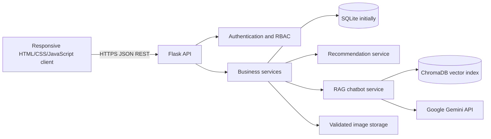
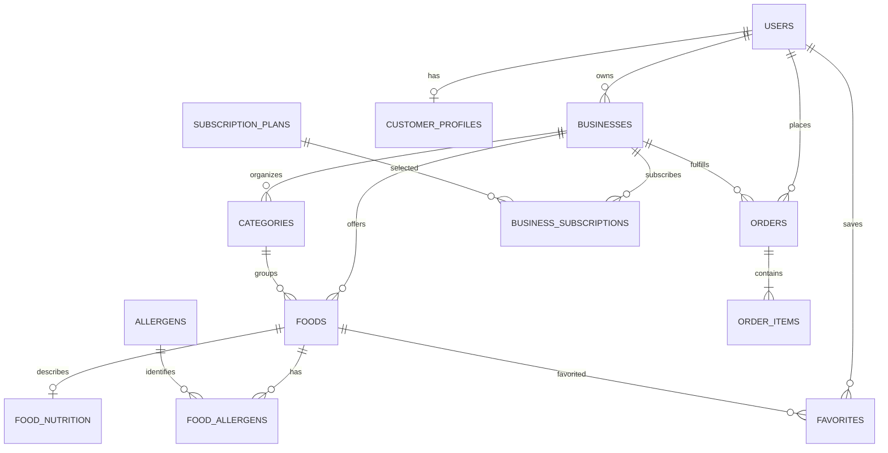

# NutriOrder AI — Architecture and Phase 1 Plan

## Current baseline

This repository already contains a small working Flask + SQLite demo: the static HTML/CSS/JavaScript client is under `frontend/`, Flask endpoints are currently concentrated in `backend/app.py`, and database initialization/seeding live in `backend/database.py` and `backend/seed.py`. The current database has only basic users, foods, orders, and order items. It does not yet implement secure authentication, owner/admin authorization, full nutrition facts, multi-business ownership, or Gemini/RAG. The design below is the intended destination; implementation will move there in increments without replacing the existing demo wholesale.

## System architecture



- **Frontend:** retain the current static pages and progressively organize shared API/auth helpers and role-specific experiences. The browser talks only to the Flask API; secrets and AI provider credentials remain server-side.
- **API/backend:** Flask routes validate requests and delegate to services. Authentication, role/business ownership checks, menu/order workflows, subscriptions, recommendations, and chat are separated responsibilities.
- **Persistence:** SQLite is the development database. Use parameterized SQL, explicit transactions, foreign keys, UTC timestamps, and versioned migrations. Keep SQL portable (integer IDs, bounded text, decimal-safe currency representation) to make a later MySQL move manageable.
- **AI:** deterministic, menu-grounded recommendation scoring is the first useful recommender. RAG retrieves approved menu/nutrition documents from ChromaDB; Gemini may phrase answers, but verified facts and retrieved citations remain authoritative. If values are unknown, present them as unavailable rather than infer them.
- **Operational boundaries:** configuration comes from environment variables, uploads are validated and stored outside executable paths, and logs must not contain passwords, tokens, or API keys.

## Incremental target folder structure

```text
NutriOrder-AI/
├── backend/
│   ├── app.py                  # Flask app factory/entry point (transition from current app.py)
│   ├── config.py               # environment-backed configuration
│   ├── database.py             # connection and migration hooks
│   ├── routes/                 # auth, foods, orders, owner, admin, AI APIs
│   ├── models/                 # persistence/data access
│   ├── services/               # ordering, subscriptions, analytics
│   ├── ai/                     # recommendation and RAG orchestration
│   ├── utils/                  # validation, errors, security helpers
│   └── migrations/              # versioned SQLite/MySQL-compatible changes
├── frontend/                   # customer and authentication pages
├── bakery/                     # owner dashboard pages (later generalized to business)
├── admin/                      # admin pages (to add)
├── css/                        # shared responsive design system
├── js/                         # page code and shared API/auth helpers
├── data/                       # non-secret sample/import data
├── rag/                         # source documents and local vector-store configuration
├── docs/                        # architecture, schema, API and setup docs
├── tests/                       # backend and API tests
├── .env.example                # names and safe local defaults only
└── requirements.txt
```

This is a destination structure, not a request to move every existing file in Phase 1. Existing URLs and demo behavior should be preserved as modules are extracted.

## Proposed relational schema

The primary keys are shown as `INTEGER` for SQLite; use `BIGINT`/auto-increment equivalents when migrating to MySQL. Store money as integer paise (for example, ₹499.00 = 49900) to avoid floating-point rounding. Foreign-key deletion behavior should be deliberate; order lines retain immutable item/price snapshots.

| Table | Important fields and purpose |
|---|---|
| `users` | `id`, normalized unique `email`, `password_hash`, `role` (`customer`, `owner`, `admin`), `display_name`, `is_active`, timestamps. Never store plaintext passwords. |
| `customer_profiles` | `user_id` PK/FK, phone, dietary preferences, allergy notes, calorie goal; optional profile data is separate from authentication. |
| `businesses` | `id`, owner `user_id`, name, type, address, approval state, contact details, timestamps. One owner may later manage multiple businesses. |
| `categories` | `id`, `business_id`, name, sort order, active flag; unique category name within a business. |
| `foods` | `id`, `business_id`, `category_id`, name, description, image path, price in paise, availability, ingredients, nutrition source/status, timestamps. |
| `food_nutrition` | `food_id` PK/FK, calories, protein/carbs/fat/fibre, unit/serving size, `data_quality` (`verified`, `estimated`, `unavailable`), source and checked timestamp. Unknown values stay NULL. |
| `allergens` | `id`, unique name. |
| `food_allergens` | composite PK (`food_id`, `allergen_id`), many-to-many allergen mapping. |
| `favorites` | composite PK (`customer_id`, `food_id`), saved foods. |
| `orders` | `id`, public `order_number`, `customer_id`, `business_id`, status, subtotal/total in paise, delivery/contact snapshot, timestamps. |
| `order_items` | `id`, `order_id`, nullable `food_id`, food name/price snapshot, quantity, nutrition snapshot where appropriate. |
| `subscription_plans` | `id`, name, monthly price in paise, feature limits/configuration, active flag; configurable plan data, not hardcoded in UI. |
| `business_subscriptions` | `id`, `business_id`, `plan_id`, status, start/end timestamps, renewal reference. |
| `reports` | `id`, reporter, target type/id, reason, review status, admin resolution fields. |

**Relationships:** users own businesses; businesses contain categories and foods; foods have one nutrition record and many allergens; customers save foods and place orders; orders belong to one customer and one business and have immutable line items; businesses subscribe to a plan. ChromaDB documents are not duplicated as relational rows; retain document metadata/source identifiers in the RAG layer.



### Compatibility and migration notes

The live demo schema is not yet this schema. Keep the existing tables and API operational while introducing additive, versioned migrations. Before changing existing user or order records, take a database backup and write a data migration; do not drop/recreate the live database as a shortcut. Normalize legacy `bakery` role/business data during the authentication/business phase.

## UI design direction

- **Palette:** deep leaf green for primary actions, warm white/cream surfaces, restrained orange for emphasis, dark readable text, and distinct success/warning/error states.
- **Layout:** responsive page shell, compact mobile navigation, accessible forms, clear empty/loading/error states, and reusable food/order cards.
- **Design tokens:** centralize color, spacing, radius, shadow, and focus-ring values in `css/style.css`; maintain visible keyboard focus and sufficient contrast.
- **Customer journey:** discover menu → inspect verified/estimated nutrition and allergens → personalize recommendations → cart/checkout → track orders.
- **Owner/admin:** task-focused dashboards with role-scoped navigation, tables that become cards on small screens, and analytics that explain their time range and source.

## Development roadmap

1. **Phase 1 — Setup, architecture, schema, UI design:** document the architecture and target schema, protect local secrets/data, provide environment configuration guidance, and establish design tokens. *(Started in this change.)*
2. **Phase 2 — Frontend:** responsive shared layout, customer/auth pages, menu details, cart/checkout, recommendations, chat, and owner/admin navigation.
3. **Phase 3 — Flask/API and database:** app factory, modular blueprints/services, migrations, validation, consistent errors, and API tests.
4. **Phase 4 — Authentication/RBAC:** password hashing, secure sessions, customer/owner/admin role checks, ownership checks, registration and profile flows.
5. **Phase 5 — Commerce:** business-scoped food/category CRUD, server-validated cart totals, checkout, immutable order lines, status workflow, favorites, and history.
6. **Phase 6 — NutriMatch:** explainable 0–100 scoring from preferences, allergens, budget, calorie goals, category, and order history; deterministic behavior and tests first.
7. **Phase 7 — NutriBot/RAG:** approved-data ingestion, chunking, embeddings, ChromaDB retrieval, Gemini answer generation, citations/grounding, and safe fallback if AI is unavailable.
8. **Phase 8 — Analytics/subscriptions:** configurable plans and limits, owner sales/preference reports, admin monitoring and moderation.
9. **Phase 9 — Hardening/deployment:** integration/security/accessibility tests, backups, production config, logging, rate limits, deployment guide, and MySQL migration rehearsal.

## Phase 1 exit checks

- Architecture, relationships, and migration strategy are recorded.
- Local secret/database files are excluded from source control; only a safe `.env.example` is committed.
- Database path can be configured without changing application code.
- The current starter schema and demo endpoints remain intact until a deliberate migration is implemented.

## NutriBot RAG flow

1. `/api/chat` validates JSON and caps question length before handing the query to the server-side RAG module.
2. The retriever reads current food rows from SQLite and chunks curated `.md`/`.txt` guidance in `rag/documents/`. Chunk metadata carries a source label and whether the content is menu data or general knowledge.
3. If a local Chroma index and Gemini key exist, semantic results are combined with live keyword matches; otherwise keyword retrieval works without an external provider. Explicit price/calorie comparisons are computed from the current menu records.
4. Gemini is instructed to use the retrieved context as evidence, not instructions, and to state missing facts rather than guess. If Gemini fails, NutriBot returns the retrieved excerpts directly.
5. The API returns answer text, source labels, grounding state, and execution mode. The browser renders model output using text nodes, not HTML.

For health-related questions, the same retrieval path passes the current menu and retrieved knowledge corpus to deterministic suitability rules. The API additionally returns a schema-validated `health_analysis` object; the frontend renders status cards and only recorded nutrition values, leaving sodium/fibre or other missing values unavailable. These rules describe general considerations and never make treatment or allergy-safety claims. The existing text answer contract is unchanged for non-health questions.

Build the local vector index with `python -m rag.ingest` after configuring the server's `GEMINI_API_KEY`. Rebuild after menu/knowledge changes to refresh semantic documents; live keyword retrieval reads SQLite on every request. The current starter schema does not record verified nutrition quality or allergens, so chat must disclose those gaps.

## NutriMatch flow

NutriMatch collects optional preferences in the browser, validates the request at `/api/nutrimatch/profile`, and submits it to deterministic scoring at `/api/nutrimatch/recommendations`. Allergy conflicts, dietary mismatches, price, meal, cuisine, and unavailable rows are filtered before fixed-weight scoring. If an allergy was selected, only items with explicit restaurant-verified allergen declarations and no known conflict may be ranked; unknowns are sent to the verification group. Profile data is not persisted. Optional age/height/weight/activity controls remain client-only and are not submitted. `/api/nutrimatch/chat` accepts current preferences per request, returns live-menu recommendations, and can retrieve local/RAG context; vector lookups use public dish names only. New nullable menu metadata is added through startup-safe SQLite column migrations.
